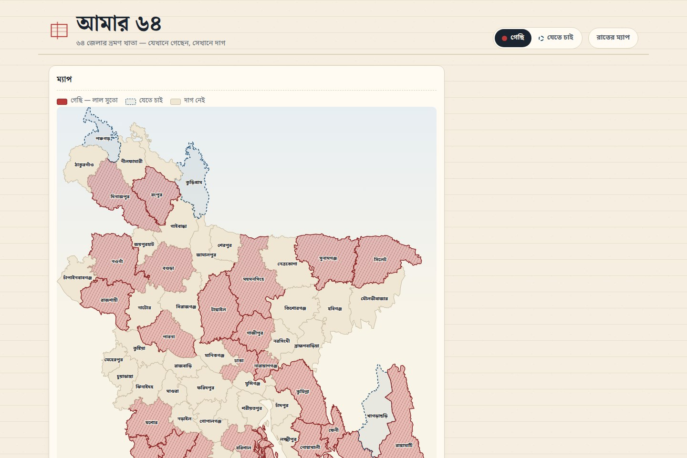
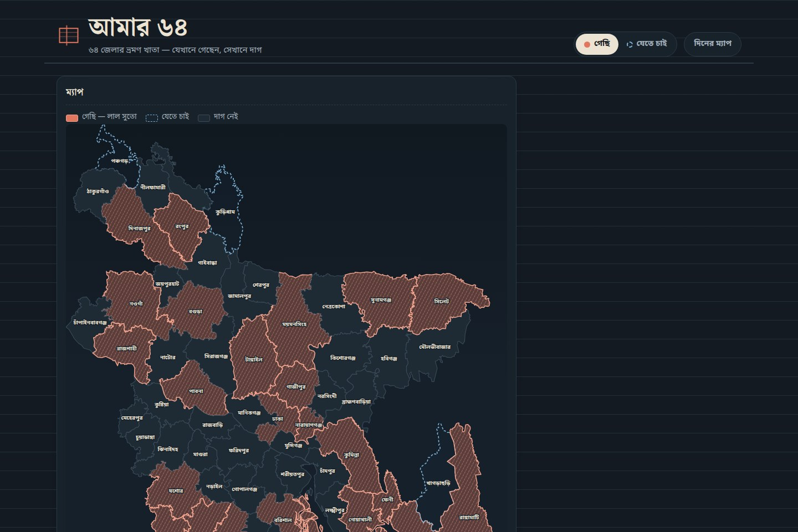

<p align="center">
  
</p>

<h1 align="center">আমার ৬৪ · Amar 64</h1>

<p align="center"><em>৬৪ জেলার ভ্রমণ খাতা — যেখানে গেছেন, সেখানে দাগ।</em></p>

**আমার ৬৪** ("my 64") is a single-page, buildless web app that turns Bangladesh's 64
districts into a personal travel ledger. You mark the districts you have been to — and the
ones you still want to visit — on a real outline map, and the page keeps a running tally: how
many jela, what share of the country's area, which of the eight divisions are finished. When
you are done you export the whole khata as an image, a poster, or plain data. It is a khata
(ledger) page: ruled paper, hairline rules, and one red kantha thread drawn across the
districts you have visited.

**Live:** https://fevnem.github.io/amar-64/

## Screenshots

| Day (khata paper) | Night (desk lamp) |
| --- | --- |
|  |  |

An example export, produced by the app itself: [A4 poster](docs/sample-poster-a4.pdf).

## What you can do

- **Mark districts.** Click a district to mark it **গেছি** (visited); switch the mode and click
  again for **যেতে চাই** (wishlist). Distances are reachable by keyboard too — arrow keys move
  between districts, Enter marks them — and the search box finds any of the 64 by Bengali or
  English name.
- **Division seals.** All eight divisions (বিভাগ) show a wax seal that fills in as you complete
  them; a division row marks or clears its whole set at once.
- **Area-based statistics.** Visited count out of 64, share of the country's area, divisions
  completed, wishlist count, and a traveller rank that climbs with your total.
- **A share link that carries the marks.** "লিংক কপি" packs your visited and wishlist marks
  into a short URL code (`#d=…`). Open that link anywhere and the same marks come back.
- **Exports.** PNG at **1× / 2× / 3×**, on a **paper**, **night** or **transparent** background,
  with optional district names and a stats strip; a vector **SVG**; an **A4 / A3 PDF poster**
  (portrait or landscape); a 9:16 **story card**; a 1200×630 **share card**; and **JSON**
  export/import of your marks.

## How it works

- **Buildless.** Plain HTML, CSS and classic scripts. No bundler, no `package.json`, no
  dependencies, no build step — open the folder and it runs.
- **The map is one inline SVG.** The 64 real district outlines are pre-projected into SVG path
  strings inside `data/districts.json` (viewBox `0 0 1000 1381`); the page fetches that file
  once and builds every district as a `<path>` in a single inline SVG.
- **State lives in the browser.** Marks are kept in `localStorage` (`amar64.state.v1`) and can
  also be encoded as a URL share code — two 64-bit bitmaps rendered to base64url in the `#d=`
  fragment.
- **Every export is generated in the browser.** PNG, story and share cards are drawn to a
  canvas and saved with a `Blob` and a temporary download link; the SVG is written out as
  vector; the PDF poster is a hand-written PDF 1.4 file; JSON is a plain serialisation of the
  current marks. Nothing is rendered or stored on a server.

## File map

| Path | What it is |
| --- | --- |
| `index.html` | The page: masthead, the single inline SVG map, the rail of panels, the colophon. |
| `css/style.css` | Palette tokens (paper, ink, kantha red, indigo, marigold, seal) and the whole look, including the night map. |
| `css/fonts.css` | `@font-face` rules for the self-hosted, subset Bengali fonts. |
| `js/bn.js` | Bengali numerals, dates and small formatting helpers (`window.BN`). |
| `js/content.js` | The Bengali copy as data — divisions, ranks, notes, tips (`window.A64C`). |
| `js/app.js` | State, the map build, the statistics and the events (`window.A64`). |
| `js/export.js` | Every download in the "নামিয়ে নিন" panel (`window.A64X`). |
| `data/districts.json` | The 64 district outlines as SVG path strings, plus names, divisions, centroids and areas. |
| `assets/favicon.svg` | The 48×48 notebook-and-red-thread favicon (light and dark browser chrome). |
| `assets/mark.svg` | The larger ledger mark, used at the top of this README and for social. |
| `assets/og.png` | The 1200×630 social card, rendered by the app's own share-card export. |
| `docs/screenshot-day.jpg` · `docs/screenshot-night.jpg` | The page as it really looks, both themes. |
| `docs/sample-poster-a4.pdf` | An example A4 poster, straight out of the PDF export. |
| `fonts/` | Noto Sans Bengali and Noto Serif Bengali (OFL), self-hosted and subset — 8 `.woff2` files (Bengali and Latin subsets). |
| `.gitignore` | Ignores `.DS_Store`, `.hermes/` and `node_modules/`. |
| `LICENSE` | MIT. |
| `README.md` | This file. |

## Data and credits

- **Geometry** (the 64 district outlines) comes from **geoBoundaries**, dataset
  `gbOpen`, level **BGD ADM2**, licensed **CC BY 3.0 IGO**. Attribution is required, and is
  shown in the page colophon.
- **District names, divisions and centroids** come from **ifahimreza/bangladesh-geojson**,
  under the **MIT** license.
- **Fonts** are **Noto Sans Bengali** and **Noto Serif Bengali**, self-hosted and subset
  (Bengali + Latin, `.woff2`), under the **SIL Open Font
  License (OFL)**. They are self-hosted and subset, so the page makes no third-party font
  requests at runtime.
- **Areas are approximate.** Per-district areas are computed from the map geometry and
  calibrated so that all 64 districts sum to the official national total of **147,570 km²**.
  Treat the area percentage as an estimate derived from the drawing, not a survey figure.

## Local preview

The page fetches `data/districts.json`, so serve it over HTTP rather than opening the file
directly:

```sh
python3 -m http.server 8160
# then open http://127.0.0.1:8160/
```

Open the folder with any static server — there is nothing to install or build.

## Privacy

Nothing leaves the browser. There is no analytics, no cookies and no third-party requests:
fonts, data and code are all served from this origin, and your marks stay in `localStorage`
unless you choose to copy a share link or export a file.

## License

MIT — see [LICENSE](LICENSE). Copyright (c) 2026 tri.
